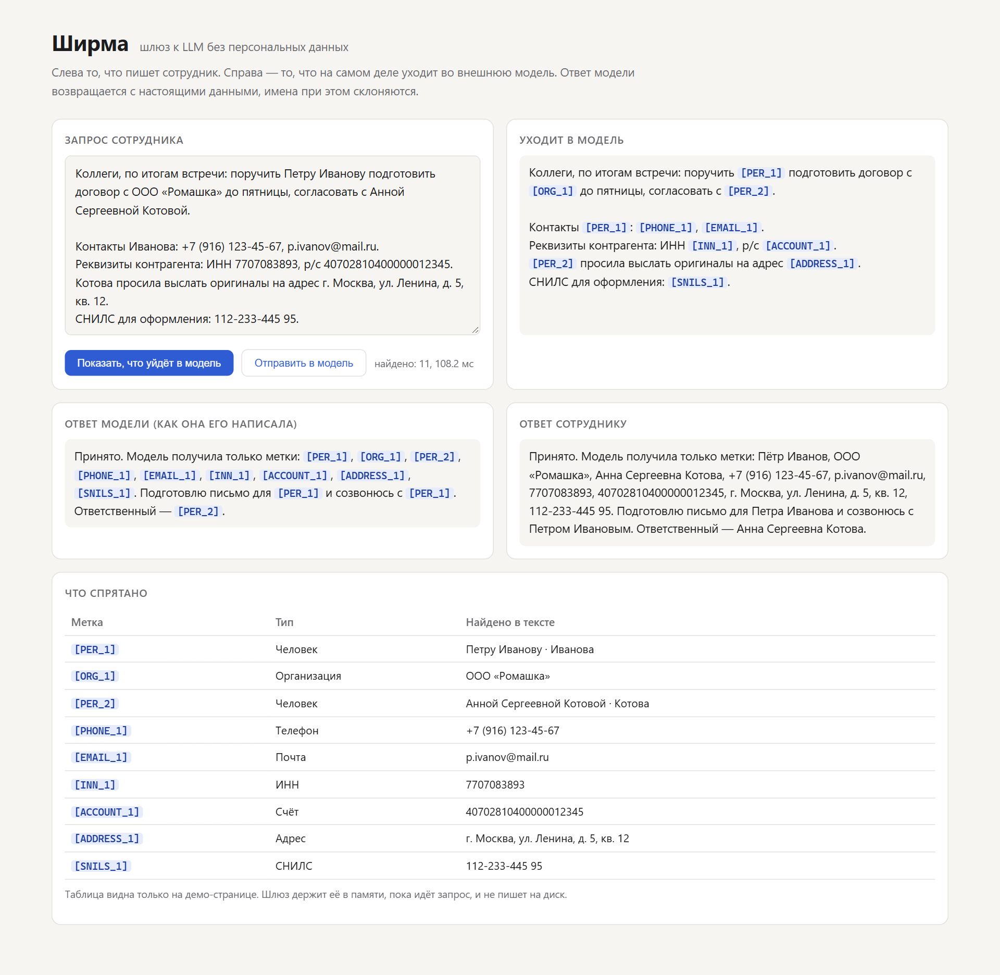
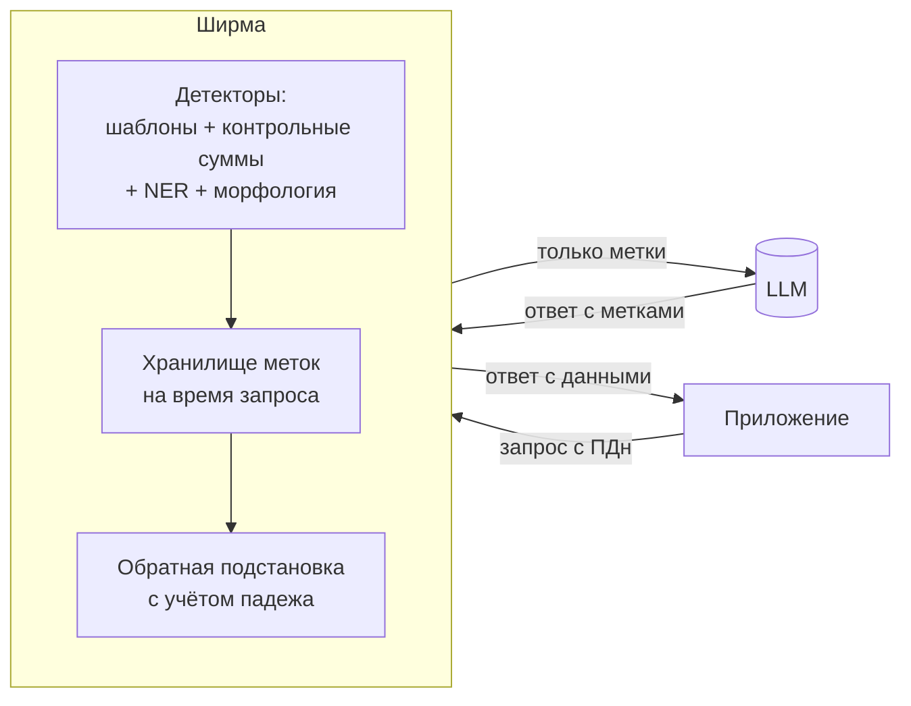

# Ширма

[](https://github.com/folenzy/shirma/actions/workflows/ci.yml)

**Шлюз к LLM, который прячет персональные данные.** Встаёт между вашим
приложением и любой моделью с API как у OpenAI (OpenAI, OpenRouter, Ollama,
LM Studio, vLLM). Перед отправкой заменяет ФИО, телефоны, ИНН, СНИЛС, карты,
паспорта, счета и адреса на метки `[PER_1]`, `[PHONE_1]`. В ответе модели
подставляет данные обратно и склоняет имена по падежам.

```diff
- Поручить Петру Иванову подготовить договор с ООО «Ромашка», тел. +7 (916) 123-45-67
+ Поручить [PER_1] подготовить договор с [ORG_1], тел. [PHONE_1]
```

Модель отвечает: «Подготовлю письмо для `[PER_1]` и созвонюсь с `[PER_1]`».
Пользователь получает: «Подготовлю письмо для **Петра Иванова** и созвонюсь
с **Петром Ивановым**».



Чтобы подключить шлюз, в приложении меняется одна строка:

```python
client = OpenAI(base_url="http://localhost:8000/v1", api_key="sk-...")
```

## Зачем

Сотрудники вставляют в чат-ботов переписку, протоколы и договоры, а там
персональные данные клиентов и коллег. Отправлять их во внешний сервис —
риск по 152-ФЗ. Ширма даёт пользоваться внешними моделями так, чтобы
персональные данные не покидали контур. Распознавание работает локально
(регулярные выражения, контрольные суммы, NER Natasha), сеть ему не нужна.

## Качество

Замер на синтетическом корпусе из 1000 деловых сообщений. Имена в нём стоят
в разных падежах, номера имеют верные контрольные суммы, есть «ловушки»:
номера заказов, суммы, города, глаголы в начале фразы.

| Тип | Значений | Скрыто полностью | Точность |
|---|---:|---:|---:|
| Люди (PER) | 920 | 99.0% | 93.4%¹ |
| Телефоны, почта, ИНН, СНИЛС, карты, паспорта, счета | 1037 | **100%** | **100%** |
| Организации (ORG) | 247 | 99.6% | 100% |
| Адреса (ADDRESS) | 130 | 99.2% | 100% |
| **Всего** | **2334** | **99.5%** | **0 ложных срабатываний** |

¹ Не ложные срабатывания: это фрагменты имён, которые попали внутрь адреса
или организации. Наружу они не уходят, но тип метки у них другой.

Маскирование одного сообщения занимает единицы или десятки миллисекунд на
CPU, почти всё это время уходит на NER. Полная таблица и способ повторить
замер — в [bench/RESULTS.md](bench/RESULTS.md).

```bash
python -m bench.run --n 1000
```

Порог качества проверяется в CI ([tests/test_benchmark.py](tests/test_benchmark.py)).
Если правка детектора уронит полноту ниже 99% или добавит хоть одно ложное
срабатывание, сборка упадёт.

## Быстрый старт

Без ключей и сети: по умолчанию ответы даёт встроенная учебная модель `mock`.

```bash
docker compose up --build
# откройте http://localhost:8000 — демо-страница
```

Или без Docker (Python 3.12+):

```bash
pip install -e ".[dev]"
shirma --port 8000
```

С настоящей моделью: Ollama на своей машине, свой ключ OpenAI или OpenRouter.

```bash
SHIRMA_UPSTREAM_URL=http://localhost:11434/v1 shirma
SHIRMA_UPSTREAM_URL=https://api.openai.com/v1 shirma   # ключ клиента пробрасывается как есть
```

| Переменная | По умолчанию | Что делает |
|---|---|---|
| `SHIRMA_UPSTREAM_URL` | `mock` | Адрес OpenAI-совместимого API |
| `SHIRMA_UPSTREAM_API_KEY` | — | Если задан, подставляется вместо ключа клиента |
| `SHIRMA_POLICY` | — | Путь к YAML-политике ([пример](policy.example.yaml)) |
| `SHIRMA_DEMO` | `true` | Демо-страница и `/api/*`; в бою выключать |

## Как это устроено



**Детекторы** ([shirma/detect](shirma/detect)):
- *По шаблонам с контрольными суммами.* ИНН, СНИЛС и карты (алгоритм Луна)
  проверяются по контрольной сумме, поэтому номер заказа из 10 цифр не
  становится ИНН. Для паспорта контрольной суммы нет, его ищем только рядом
  со словами «паспорт» или «серия».
- *NER Natasha* — для людей, организаций и мест. Модель весит около 30 МБ,
  поставляется вместе с пакетом и работает офлайн.
- *Поправки морфологией* (pymorphy3) там, где NER ошибается:
  - добирает отрезанную фамилию или отчество;
  - срезает приклеившийся глагол («[Напомните Лыткиной]»);
  - не принимает «Банк» и «Перезвони» в начале фразы за организацию;
  - распознаёт фамилию, которую NER принял за город.

**Кто есть кто** ([shirma/morph.py](shirma/morph.py)). «Петру Иванову»,
«Иванов» и «Пётр Иванов» сводятся к именительному падежу и получают одну
метку `[PER_1]`. «Мария Иванова» получает другую метку: имя другое, хотя
фамилия общая. Учитываются род и инициалы.

**Обратная подстановка.** Падеж определяется по предлогу перед меткой:
«для [PER_1]» → «для Петра Иванова», «с [PER_1]» → «с Петром Ивановым».

**Потоковый режим** ([shirma/stream.py](shirma/stream.py)). Модель отдаёт
ответ кусками по несколько символов, и метка может разорваться: `[PE` +
`R_1]`. Шлюз придерживает только хвост, который может оказаться началом
метки (не больше 15 символов), а остальной текст отдаёт сразу. Корректность
проверяется тестом на свойства (hypothesis): при любой нарезке потока клиент
получает тот же текст, что и без потока.

**Вызовы инструментов.** Аргументы tool calls — это JSON внутри строки.
Значения подставляются с JSON-экранированием, поэтому `ООО "Ромашка"` с
кавычками не ломает аргументы.

**Что не хранится.** Таблица «метка → значение» живёт в памяти, пока идёт
запрос. В журнал попадают только счётчики по типам и время, без значений.
В ответе есть заголовок `x-shirma-masked: PER=2,PHONE=1`.

## Известные ограничения

- Падеж определяется только по предлогу. После глагола («позвоните
  [PER_1]») имя остаётся в именительном падеже. Следующий шаг — смотреть
  на управление глагола.
- Редкие имена, которые совпадают с обычными словами (Олимпиада, Мир),
  NER иногда пропускает, если рядом нет отчества.
- Корпус синтетический и собран по шаблонам. На живых текстах полнота будет
  ниже, поэтому в бою стоит держать журнал срабатываний и пополнять корпус.
- Пока поддерживается только формат OpenAI Chat Completions. Anthropic
  Messages API — в планах (у Anthropic есть и OpenAI-совместимый адрес).

## Разработка

```bash
pip install -e ".[dev]"
pytest                    # 61 тест: детекторы, морфология, поток, API, порог качества
ruff check . && ruff format --check .
python -m bench.run       # бенчмарк
```

Структура:

```
shirma/
  detect/       детекторы: шаблоны, контрольные суммы, NER, разрешение пересечений
  morph.py      имена: нормализация, «тот же человек», склонение
  vault.py      метки на время запроса, обратная подстановка
  stream.py     потоковая подстановка для SSE
  proxy.py      маскирование запроса и восстановление ответа OpenAI
  app.py        FastAPI: /v1/chat/completions, /v1/models, демо
  mock_upstream.py  учебная модель для демо и тестов
bench/          синтетический корпус и замер качества
tests/
```
